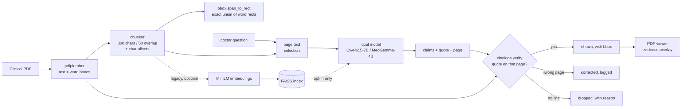

# EUNOCURA
**An open-weight AI harness for trustworthy clinical intelligence..**

Point it at a medical PDF. It extracts structured clinical facts, answers questions
about the document, and — the part that matters — **refuses to show a claim it cannot
quote from the page it cites.**

Zero API keys. Zero paid services. Runs on a laptop, offline.

```
claim offered by the model  →  "TLC 14,200 per microlitre"  · page 2
claim shown to the doctor   →  only if page 2 really says that
otherwise                   →  dropped, with the reason printed
```

---

## 0. Built on, and what we changed


Our delta, in the order it matters:

| # | Change | Where |
|---|---|---|
| 1 | **Citation-or-drop.** The model may only *offer* `{claim, quote, page}`; deterministic Python decides whether that line exists on that page. A wrong page is corrected, a missing line is dropped, and the drop is shown to the doctor. No model influences the verdict. | `backend/src/services/citations.py` |
| 2 | **19 offline tests** for the verifier — no model, no network, runs at a venue whose wifi does not work. | `backend/tests/test_citations.py` |
| 3 | **Replaced the dead model.** Upstream pinned `gemini-2.0-flash-exp`, which Google has shut down, so the diagnosis path was already broken. One router: open weights by default (Ollama), Gemma 4 optional, `none` for deterministic-only. | `backend/src/llm/router.py` |
| 4 | **Deleted the embedding stack from the demo path.** `faiss-cpu`, `sentence-transformers` and `torch` moved to `requirements-optional.txt`: ~2.5 GB → under 300 MB. Verification got *more* exact, because page text answers "is this line on that page" better than cosine similarity does. | `backend/requirements.txt` |
| 5 | **Audit trail.** Every audit — including rejected claims and the reason for rejection — is written to `citation_audits` in MongoDB. | `backend/src/services/audit_store.py` |
| 6 | **Deployable.** Container plus a DigitalOcean App Platform spec (BLR1) for the API and the static site. | `backend/Dockerfile`, `.do/app.yaml`, `docker-compose.yml` |
| 7 | **The portals are wired, not posted.** Prescriptions, lab results, care plan and notifications are real collections with real routes; the screens that showed sample rows now read the API and have loading / error / empty states. §4 lists the single fixture that remains. | `backend/src/routes/{prescription,lab_result,care_plan,notification}.py`, `frontend/src/components/` |
| 8 | **Every read is scoped to the caller.** `GET /appointments/` used to return the whole collection to an anonymous request — names, ages and complaints included. Reads now require a bearer token and are filtered by role; a stranger asking for someone else's visit gets 404, not 403. | `backend/src/routes/appointment.py` |
| 9 | **A patient can book.** Upstream only let a *doctor* create a visit, so booking was impossible server-side. `bookable-doctors`, `self` and `cancel` close that without touching the doctor flow. | `backend/src/routes/booking.py` |
| 10 | **One-command demo data + CI gate.** `tools/seed_all.py` builds the demo database; `scripts/ci_checks.py` is the same 14-check gate GitHub Actions runs. | `backend/tools/`, `backend/scripts/ci_checks.py`, `.github/workflows/ci.yml` |

## 1. The rule the project is built on

> **Citation-or-drop.** A claim survives only if a line it quotes actually exists on
> the page it cites. No quote, no claim. Wrong page, we fix the page or drop it.

That check is **plain string work in Python**, in `backend/src/services/citations.py`.
It never runs through a model. The model's only job is to *offer* claims with a quote
and a page number; `verify()` decides whether that offer is worth showing to a doctor.
Each surviving claim gets the exact bounding box of the words it rests on, so the PDF
viewer can point at the line instead of paraphrasing it.

This is the part a judge can break on purpose and watch hold.

---

## 2. Models

Every model is open-weight. Nothing is called unless it is installed locally, except
the optional Gemini fallback which is off by default.

| Role | Model | Params | Licence | Where |
|---|---|---|---|---|
| Extraction, intent, chat (default) | [`Qwen/Qwen2.5-7B-Instruct`](https://huggingface.co/Qwen/Qwen2.5-7B-Instruct) | 7B | Apache-2.0 (OSI) | `OLLAMA_SLM_MODEL` |
| Clinical reasoning (default) | [`google/medgemma-4b-it`](https://huggingface.co/google/medgemma-4b-it) | 4B | Health AI Developer Foundations terms — **open weights, not OSI** | `OLLAMA_MED_MODEL` |
| Embeddings (legacy, optional) | [`sentence-transformers/all-MiniLM-L6-v2`](https://huggingface.co/sentence-transformers/all-MiniLM-L6-v2) | 22M | Apache-2.0 (OSI) | `pdf_rag.py` only — installed via `requirements-optional.txt`, **not on the citation path** |
| Optional cloud fallback | [`gemma-4-26b-a4b-it`](https://ai.google.dev/gemma) via the Gemini API | 26B (4B active) | Gemma Terms of Use — **open weights, not OSI** | `LLM_PROVIDER=gemini` |
| Historical (not used by default) | [`m42-health/Llama3-Med42-70B`](https://huggingface.co/m42-health/Llama3-Med42-70B) | 70B | Llama 3 Community Licence + Med42 terms | replaced by the local `med` profile |

**Licence honesty.** Our code is **Apache-2.0** (`LICENSE`); the upstream files we forked
stay under **MIT** (`LICENSE-MIT-upstream`), and `NOTICE` records that split. Both are on the
OSI approved list (<https://opensource.org/licenses>). The *models* are not all OSI — two of
them carry custom open-weight terms. Pulling a model means accepting its provider terms;
EUNOCURA does not redistribute weights.

**Ollama tags.** `OLLAMA_MED_MODEL` ships as `medgemma:4b`. If that tag is not on your
Ollama registry, set it to any medical model you have pulled (for example
`ollama pull llama3.1:8b`) — the profile is a config value, not a hard dependency.

### Why local

A hospital cannot paste a discharge summary into a public API to find out what it says.
Local open weights are the only version of this product that could ever be deployed.
It also means the demo works when the venue wifi does not.

---

## 3. Quick start (no keys)

```bash
# 1. models (one-time)
ollama serve
ollama pull qwen2.5:7b-instruct
ollama pull medgemma:4b          # or any medical model you prefer

# 2. backend
cd backend
python -m venv .venv && .venv\Scripts\activate     # Windows
pip install -r requirements.txt
cp .env.example .env                                # optional: every value has a default
python scripts/preflight.py                         # what is actually operational?
python tools/seed_all.py                            # demo patients, visits, records
uvicorn src.server:app --reload --port 8000

# 3. frontend
cd ../frontend
npm install
npm run dev
```

Then:

* `http://localhost:8000/healthz` — model / Mongo / storage / STT / RAG status
* `http://localhost:8000/docs` — OpenAPI
* `http://localhost:5173` — doctor and patient portals

Demo accounts after `tools/seed_all.py`:

| Role | Email | Password |
|---|---|---|
| Patient (Asha Rao) | `demo.patient@eunocura.dev` | `Demo@2026` |
| Doctor | `demo.doctor@eunocura.dev` | `Demo@2026` |

**Nothing above requires an account, a card or a key.** If `ollama` is absent the API
still boots and `/healthz` says `degraded` with the exact command to fix it.
MongoDB is the same: absent means the portals have no data, not that the server dies.

### Degrade matrix

| Missing | What happens |
|---|---|
| Ollama / model weights | `/healthz` → degraded; model routes return a fix hint; cached answers still replay |
| `MONGODB_URI` | Portals show no data (`/healthz` → degraded); AI + document paths still work |
| R2 credentials | Uploads go to `backend/data/uploads`, served at `/files/<name>` |
| `faster-whisper` | Text-only mode; audio endpoints return a fix hint |
| `faiss` / `sentence-transformers` | Document RAG reports unavailable with the reason; citations and extraction on supplied text still work |
| A policy-blocked DLL (Windows Application Control) | The optional import is caught at first use, `/healthz` prints the exception text, the rest of the API keeps working. `src/__init__.py` also installs a pure-Python `xxhash` stand-in when the compiled one is blocked, because that one *does* stop the app booting |

---

## 4. What is real, and what is a fixture

Judges log in as a new patient. Every screen that is not wired to a backend says so,
in the UI.

### Real — backend + frontend

| Feature | Implementation |
|---|---|
| Auth | JWT (HTTPBearer), Argon2 hashing, 7-day tokens. The password hash is server-owned: a signup never sends one |
| Appointments | create / list / read / update in MongoDB. **Every read is scoped to the caller** — a patient sees only their own visits, a doctor only the visits they are the doctor for |
| Patient booking | `GET /appointments/bookable-doctors`, `POST /appointments/self` (the patient books for themselves; `patient_id` comes from the token, never the body), `PATCH /appointments/{id}/cancel` (own visit, future only) |
| Patient records | MongoDB, access checked per doctor–patient relationship |
| Prescriptions | `prescriptions` collection — doctor writes, patient reads their own, status enum validated server-side |
| Lab results | `lab_results` collection — the normal / high / low flag is **derived from the reference range on every read**, never trusted from the client |
| Care plan | `care_plans` collection — one plan per patient, doctor writes. A patient with no plan gets an empty answer, not an invented one |
| Notifications | `notifications` collection — per-user inbox with read / read-all / delete; someone else's row is a 404, not a 403 |
| Document extraction | pdfplumber → model → structured clinical JSON → MongoDB |
| **Citation verification** | `services/citations.py` — claim kept only if its quote exists on the cited page; wrong-page claims corrected; the rest dropped |
| **Exact highlight boxes** | chunk → character span → union of pdfplumber word rects (`services/bbox.py`). No ±50 pt guessing |
| Document RAG (legacy, optional) | FAISS + MiniLM embeddings, per-document index. Installed only via `requirements-optional.txt`; **not used by the citation path** |
| AI diagnosis | `med` profile over patient context, differential with confidence |
| Patient chatbot | `slm` profile, 12 Indic languages, optional voice |
| Speech-to-text | local faster-whisper; text-only degrade if absent |
| File storage | R2 if configured, else local disk served by the API |
| Health / preflight / CI | `/healthz`, `scripts/preflight.py`, `scripts/ci_checks.py` (the same gate GitHub Actions runs) |

Every screen that fills itself from these endpoints has a loading state, a readable
error with a retry, and an empty state that says nothing is on file. None of them
substitutes sample rows for an empty answer.

### Fixture data — labelled in the UI

| Screen | Status |
|---|---|
| Diet plan — **only when the patient has no clinician plan** | the sample plan from `src/data/dummyData.js`, behind the amber "Interactive preview · fixture data" banner, plus a line saying no plan is on file. The moment a doctor writes a plan the banner disappears and the real one renders |

That is the whole list. Medications, notifications, test-result charts, the care plan,
the appointment list, the patient dashboard and the doctor's clinical panel all read
the API. The earlier README called those screens "fully functional" when they were
fixtures; the pass that wired them is recorded in `COMPLETE-SPEC.md`.

---

## 5. Agent Skill

The document core is also packaged as an Agent Skill, so the same pipeline can run
inside Claude Code, OpenCode or any harness that reads `SKILL.md`:

```
.agents/skills/clinical-document-intelligence/
├── SKILL.md
├── scripts/
│   ├── build_index.py        # PDF → chunks + FAISS index
│   ├── query_pdf.py          # question → chunks with page + bbox (+ evidence PNG)
│   └── extract_clinical.py   # PDF → structured JSON, verified citation-or-drop
├── references/
│   └── extraction-schema.md  # the JSON Schema the model must satisfy
└── assets/
    └── sample-discharge-summary.pdf
```

```bash
python .agents/skills/clinical-document-intelligence/scripts/extract_clinical.py \
  --pdf .agents/skills/clinical-document-intelligence/assets/sample-discharge-summary.pdf
```

Same engine, same verification, no web app required.

---

## 6. Architecture



The verifier sits *beside* the model, not inside it. Removing the model leaves a tool
that can still split, index and verify; removing the verifier leaves an untrustworthy one.

The dotted branch is the upstream vector path. It is kept runnable, installed only
through `requirements-optional.txt`, and is **not** on the demo path: page text plus
quote matching answers "is this line on that page" exactly, cosine similarity does not.

---

## 7. API

All routes below, except `/healthz`, `/health` and the two signup/login calls, require
`Authorization: Bearer <token>` from `POST /auth/login`.

| Method | Path | Purpose |
|---|---|---|
| `GET` | `/healthz`, `/health` | Subsystem status for the live demo |
| `POST` | `/auth/signup/doctor`, `/auth/signup/patient`, `/auth/login` | Auth — `GET /auth/me` returns the caller |
| `GET` | `/patients/`, `/patients/{id}` | Patient panel (doctor only) |
| `GET` | `/doctors/` | Doctor directory, projected: no password hashes |
| `GET`, `POST` | `/appointments/` | List (scoped to the caller) / create |
| `GET`, `PATCH` | `/appointments/{id}` | Read (scoped) / update — a patient may only cancel |
| `GET` | `/appointments/total` | Completed-visit count, scoped |
| `GET` | `/appointments/bookable-doctors` | Directory the booking form reads |
| `POST` | `/appointments/self` | A patient books a slot for themselves |
| `PATCH` | `/appointments/{id}/cancel` | A patient cancels their own upcoming visit |
| `POST` | `/appointments/{id}/diagnosis`, `/doctor-diagnosis`, `/finalize-recording`, `/upload-diagnosis-files`, `/transcribe-file` | Visit AI, recording, uploads |
| `GET` | `/prescriptions/me`, `/prescriptions/patient/{id}` | Read prescriptions (own / as the doctor of that patient) |
| `POST`, `PATCH` | `/prescriptions/`, `/prescriptions/{id}` | Doctor writes / updates |
| `GET`, `POST` | `/lab-results/me` (+ `/me/series`), `/lab-results/` | Trends, grouping, doctor entry |
| `GET`, `PUT` | `/care-plan/me`, `/care-plan/patient/{id}` | Read the plan / doctor upserts one |
| `GET` | `/notifications/me` | Own inbox + unread count |
| `POST` | `/notifications/`, `/notifications/{id}/read`, `/notifications/read-all` | Doctor notifies; mark read |
| `DELETE` | `/notifications/{id}` | Delete one of your own |
| `POST` | `/citations/check`, `/audit`, `/index`; `GET /audits`, `/health` | The verifier on its own — no model required |
| `POST` | `/doctors/chat`, `/doctors/upload-pdf`, `/doctors/chat/history`; `GET /doctors/pdf/{id}` | Grounded Q&A over records or a PDF |
| `POST` | `/chatbot/text`, `/chatbot/voice`, `/chatbot/speak`; `GET /chatbot/languages` | Patient assistant |
| `POST` | `/ingest/document/{id}`, `/ingest/text/{id}`, `/ingest/transcript/{id}` | Document → text → chunks |
| `GET` | `/files/<name>` | Local storage fallback |

---

## 8. Repository layout

```
backend/
  src/server.py                   # app wiring, /healthz, static /files mount
  src/__init__.py                 # boot hooks (see "Boot" below)
  src/llm/router.py               # the only model client (Ollama / optional Gemini)
  src/middlewares/auth.py         # bearer token -> user, doctor-only dependency
  src/services/citations.py       # citation-or-drop verifier
  src/services/bbox.py            # exact word-rect geometry + evidence PNG renderer
  src/services/pdf_rag.py         # extraction, chunking, FAISS (lazy, optional)
  src/services/whisper_service.py # faster-whisper → text-only
  src/models/                     # pydantic contracts per collection
  src/routes/root.py              # every router mount, in one place
  src/routes/                     # auth, patients, appointments, booking, doctor,
                                  # prescriptions, lab results, care plan,
                                  # notifications, citations, ingest, chatbot
  scripts/preflight.py            # 9-check readiness report
  scripts/ci_checks.py            # the gate CI runs: compile, tests, boot, secrets
  scripts/render_bboxes.py        # PDF page → highlighted_evidence.png
  tools/seed_all.py               # one command → a demo database
  tests/                          # offline tests, no API key required
  vendor/xxhash/                  # pure-Python stand-in, see "Boot" below
frontend/                         # React 18 + Vite + Tailwind + Recharts
  src/data/previewDietPlan.js     # the only fixture left (see §4)
.github/workflows/ci.yml          # backend gate, frontend build, optional docker
.agents/skills/clinical-document-intelligence/
```

### Boot

`import src.server` used to take ~90 s, and on this machine it fails outright:
`langchain-core` pulls in `langsmith`/`langgraph`, which import a compiled
`xxhash` DLL, and Windows Application Control blocks it — so the API could not
start at all.

Two things fixed that, and both are load-bearing:

1. **Optional, slow dependencies are imported on first use, not on import.**
   FAISS/torch (via `pdf_rag`), faster-whisper, faster-whisper's ctranslate2,
   the chat clients and `boto3` are all resolved when a request actually needs
   them. `/healthz` probes them off the event loop under a timeout.
2. **`src/__init__.py` installs a pure-Python `xxhash` stand-in** (BLAKE2b
   backed, same API surface) *only if the compiled module fails to import*. It
   lives in `backend/vendor/xxhash/` and is prepended to `sys.path` for that
   case alone. Nothing else in the app depends on it.

Measured result on the Windows box this was built on: boot **0.7 s** (was ~90 s
failing, ~16 s once the DLL was bypassed), `/healthz` **326 ms** warm.

---

## 9. Tests

```bash
cd backend
python tests/test_citations.py      # verifier: no model, no network
python tests/test_bboxes.py         # geometry: no PDF library needed
python tests/test_prescriptions.py  # record contract, no database
python tests/test_lab_results.py    # status is derived, never trusted
python tests/test_care_plan.py      # one plan per patient
python tests/test_notifications.py  # inbox contract
python tests/test_routes_smoke.py   # 27 live round-trips + auth negatives
```

`test_routes_smoke.py` is the only one that needs MongoDB (it skips itself with a
readable line when `mongod` is absent, and deletes every document it creates).
The rest run with nothing but the repo.

The whole gate, exactly as CI runs it:

```bash
cd backend && python scripts/ci_checks.py     # 14 checks, ~8 s warm
```

It compiles `src/tests/tools/scripts`, runs every suite in its own subprocess,
boots the app in a child process and asserts the documented paths exist, scans
`backend/src` for credential shapes, and proves `.env`/`dist/` are ignored.

They exist because the parts that decide whether a claim is shown must be
provable without a model in the loop.

---

## 10. Limits

* **Not a medical device.** No regulatory clearance, no clinical validation. It is a
  document-reading harness for a demo, and the UI says so.
* Verification proves *the document says it*, not *the document is right*. A wrong lab
  value quoted accurately is still shown — with its box, so a human can judge it.
* The default 4B medical model is small. It will miss things. That is why every claim
  is quotable and every quote is checkable.
* `bookable-doctors` is a directory, not availability: the booking form offers a fixed
  09:00–17:00 / 30-minute grid because no scheduling service exists to ask. The server
  refuses past slots, so a stale tab cannot book history.
* There is no appointment reminder job, no email/SMS. The notification inbox is in-app
  only and a doctor has to write the entry.
* No video consult, no e-signature, no lab-order integration. Those are out of scope,
  and nothing in the UI pretends otherwise.
* FAISS indexes are in-memory; a restart rebuilds them. On a machine where the DLL is
  blocked the whole vector branch reports itself unavailable rather than half-working.

---

## 12. The Android app

A debug APK is available at `EUNOCURA.apk` (or build with `npm run mobile:apk`).

### What it is

* **Debug-build signing only.** The APK is signed with the debug keystore, not a
  release key. It will not publish to Google Play.
* **Development API endpoint.** The bundled `PRODUCTION_API_BASE_URL` points at
  the deployed Vercel API (`https://eunocura-backend.vercel.app`). Set
  `EUNOCURA_API_BASE=http://10.0.2.2:8000` as an env var or use the Settings
  sheet to point at a local backend.
* **Mixed-content allowed.** `capacitor.config.ts` uses `androidScheme: 'http'`,
  `cleartext: true`, and `webContentsDebuggingEnabled: true` so the app can
  talk to a local HTTP server. These are all wrong for a store release.
* **Generation backend = Gemini.** The production API calls Gemini for text
  generation. A local `ollama` endpoint is available if you override `EUNOCURA_API_BASE`.

### Building yourself

```bash
cd frontend
npm run mobile:apk          # builds, syncs, assembles app-release.apk
```

The output is at `android/app/build/outputs/apk/release/app-release.apk`.

### Debug keys

To reinstall over an existing debug build:

```powershell
adb install -r android\sdk\platform-tools\...
```

—or use Files on the device, since HyperOS may block `adb install` via
`INSTALL_FAILED_USER_RESTRICTED`.

### Limitations of this build

| | |
|---|---|
| **Not a store release** | No production signing key, no Play Store listing |
| **Debug key** | Anyone can install it, but it cannot be pushed to a device as an upgrade over a released APK |
| **HTTP API** | The bundled default works out of the box because the API is TLS; local override is optional |
| **App icon cache** | On MIUI/HyperOS, the launcher icon may stay cached. Force-stop the launcher or reboot if it looks stale |

### Verifying on device

1. Install the APK (via `adb install -r` or Files app).
2. Open the app; the landing screen shows "EUNOCURA".
3. Log in with `demo.patient@eunocura.dev` / `Demo@2026`.
4. Open the device system browser and compare to `https://eunocura.vercel.app`.

Both portals (patient and doctor) load the same React bundle, with bottom navigation
and dark mode toggle functional.
