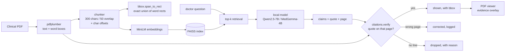

# EUNOCURA
**An open-weight AI harness for trustworthy clinical intelligence..**

Point it at a medical PDF. It extracts structured clinical facts, answers questions
about the document, and — the part that matters — **refuses to show a claim it cannot
quote from the page it cites.**

Zero API keys. Zero paid services. Runs on a laptop, offline.

```
claim offered by the model  →  "TLC 14,200 per microlitre"  · page 2
claim shown to the doctor   →  only if page 2 really says that
otherwise                   →  dropped, with the reason printed
```

---

## 0. Built on, and what we changed

This is a fork. The upstream project is **EUNOCURA**, published as **MedAI**
(<https://github.com/Prathameshworks247/MedAI>). It gave us the FastAPI app, the
MongoDB models and the React doctor portal. Those files keep their original
authorship and their MIT notice (`LICENSE-MIT-upstream`); `git log` shows the
history we did not write.

Our delta, in the order it matters:

| # | Change | Where |
|---|---|---|
| 1 | **Citation-or-drop.** The model may only *offer* `{claim, quote, page}`; deterministic Python decides whether that line exists on that page. A wrong page is corrected, a missing line is dropped, and the drop is shown to the doctor. No model influences the verdict. | `backend/src/services/citations.py` |
| 2 | **19 offline tests** for the verifier — no model, no network, runs at a venue whose wifi does not work. | `backend/tests/test_citations.py` |
| 3 | **Replaced the dead model.** Upstream pinned `gemini-2.0-flash-exp`, which Google has shut down, so the diagnosis path was already broken. One router: open weights by default (Ollama), Gemma 4 optional, `none` for deterministic-only. | `backend/src/llm/router.py` |
| 4 | **Deleted the embedding stack from the demo path.** `faiss-cpu`, `sentence-transformers` and `torch` moved to `requirements-optional.txt`: ~2.5 GB → under 300 MB. Verification got *more* exact, because page text answers "is this line on that page" better than cosine similarity does. | `backend/requirements.txt` |
| 5 | **Audit trail.** Every audit — including rejected claims and the reason for rejection — is written to `citation_audits` in MongoDB. | `backend/src/services/audit_store.py` |
| 6 | **Deployable.** Container plus a DigitalOcean App Platform spec (BLR1) for the API and the static site. | `backend/Dockerfile`, `.do/app.yaml`, `docker-compose.yml` |

## 1. The rule the project is built on

> **Citation-or-drop.** A claim survives only if a line it quotes actually exists on
> the page it cites. No quote, no claim. Wrong page, we fix the page or drop it.

That check is **plain string work in Python**, in `backend/src/services/citations.py`.
It never runs through a model. The model's only job is to *offer* claims with a quote
and a page number; `verify()` decides whether that offer is worth showing to a doctor.
Each surviving claim gets the exact bounding box of the words it rests on, so the PDF
viewer can point at the line instead of paraphrasing it.

This is the part a judge can break on purpose and watch hold.

---

## 2. Models

Every model is open-weight. Nothing is called unless it is installed locally, except
the optional Gemini fallback which is off by default.

| Role | Model | Params | Licence | Where |
|---|---|---|---|---|
| Extraction, intent, chat (default) | [`Qwen/Qwen2.5-7B-Instruct`](https://huggingface.co/Qwen/Qwen2.5-7B-Instruct) | 7B | Apache-2.0 (OSI) | `OLLAMA_SLM_MODEL` |
| Clinical reasoning (default) | [`google/medgemma-4b-it`](https://huggingface.co/google/medgemma-4b-it) | 4B | Health AI Developer Foundations terms — **open weights, not OSI** | `OLLAMA_MED_MODEL` |
| Embeddings (legacy, optional) | [`sentence-transformers/all-MiniLM-L6-v2`](https://huggingface.co/sentence-transformers/all-MiniLM-L6-v2) | 22M | Apache-2.0 (OSI) | `pdf_rag.py` only — installed via `requirements-optional.txt`, **not on the citation path** |
| Optional cloud fallback | [`gemma-4-26b-a4b-it`](https://ai.google.dev/gemma) via the Gemini API | 26B (4B active) | Gemma Terms of Use — **open weights, not OSI** | `LLM_PROVIDER=gemini` |
| Historical (not used by default) | [`m42-health/Llama3-Med42-70B`](https://huggingface.co/m42-health/Llama3-Med42-70B) | 70B | Llama 3 Community Licence + Med42 terms | replaced by the local `med` profile |

**Licence honesty.** Our code is **Apache-2.0** (`LICENSE`); the upstream files we forked
stay under **MIT** (`LICENSE-MIT-upstream`), and `NOTICE` records that split. Both are on the
OSI approved list (<https://opensource.org/licenses>). The *models* are not all OSI — two of
them carry custom open-weight terms. Pulling a model means accepting its provider terms;
EUNOCURA does not redistribute weights.

**Ollama tags.** `OLLAMA_MED_MODEL` ships as `medgemma:4b`. If that tag is not on your
Ollama registry, set it to any medical model you have pulled (for example
`ollama pull llama3.1:8b`) — the profile is a config value, not a hard dependency.

### Why local

A hospital cannot paste a discharge summary into a public API to find out what it says.
Local open weights are the only version of this product that could ever be deployed.
It also means the demo works when the venue wifi does not.

---

## 3. Quick start (no keys)

```bash
# 1. models (one-time)
ollama serve
ollama pull qwen2.5:7b-instruct
ollama pull medgemma:4b          # or any medical model you prefer

# 2. backend
cd backend
python -m venv .venv && .venv\Scripts\activate     # Windows
pip install -r requirements.txt
cp .env.example .env                                # optional: every value has a default
python scripts/preflight.py                         # what is actually operational?
uvicorn src.server:app --reload --port 8000

# 3. frontend
cd ../frontend
npm install
npm run dev
```

Then:

* `http://localhost:8000/healthz` — model / Mongo / storage / STT / RAG status
* `http://localhost:8000/docs` — OpenAPI
* `http://localhost:5173` — doctor and patient portals

**Nothing above requires an account, a card or a key.** If `ollama` is absent the API
still boots and `/healthz` says `degraded` with the exact command to fix it.
MongoDB is the same: absent means the portals have no data, not that the server dies.

### Degrade matrix

| Missing | What happens |
|---|---|
| Ollama / model weights | `/healthz` → degraded; model routes return a fix hint; cached answers still replay |
| `MONGODB_URI` | Portals show no data; AI + document paths still work |
| R2 credentials | Uploads go to `backend/data/uploads`, served at `/files/<name>` |
| `faster-whisper` | Text-only mode; audio endpoints return a fix hint |
| `faiss` / `sentence-transformers` | Document RAG reports unavailable; citations and extraction on supplied text still work |

---

## 4. What is real, and what is a fixture

Judges log in as a new patient. Every screen that is not wired to a backend says so,
in the UI.

### Real — backend + frontend

| Feature | Implementation |
|---|---|
| Auth | JWT (HTTPBearer), Argon2 hashing, 7-day tokens |
| Appointments | CRUD + status transitions, MongoDB |
| Patient records | MongoDB, access checked per doctor–patient relationship |
| Document extraction | pdfplumber → model → structured clinical JSON → MongoDB |
| **Citation verification** | `services/citations.py` — claim kept only if its quote exists on the cited page; wrong-page claims corrected; the rest dropped |
| **Exact highlight boxes** | chunk → character span → union of pdfplumber word rects (`services/bbox.py`). No ±50 pt guessing |
| Document RAG (legacy, optional) | FAISS + MiniLM embeddings, per-document index. Installed only via `requirements-optional.txt`; **not used by the citation path** |
| AI diagnosis | `med` profile over patient context, differential with confidence |
| Patient chatbot | `slm` profile, 12 Indic languages, optional voice |
| Speech-to-text | local faster-whisper; text-only degrade if absent |
| File storage | R2 if configured, else local disk served by the API |
| Health/preflight | `/healthz` + `scripts/preflight.py` |

### Fixture data — labelled in the UI

| Screen | Status |
|---|---|
| Medications | `src/data/dummyData.js` — amber "Interactive preview · fixture data" banner |
| Diet plan | same banner |
| Notifications | same banner |
| Test result charts | same banner; upload/OCR not implemented |

The earlier README called these "fully functional". They are not, and they no longer
claim to be.

---

## 5. Agent Skill

The document core is also packaged as an Agent Skill, so the same pipeline can run
inside Claude Code, OpenCode or any harness that reads `SKILL.md`:

```
.agents/skills/clinical-document-intelligence/
├── SKILL.md
├── scripts/
│   ├── build_index.py        # PDF → chunks + FAISS index
│   ├── query_pdf.py          # question → chunks with page + bbox (+ evidence PNG)
│   └── extract_clinical.py   # PDF → structured JSON, verified citation-or-drop
├── references/
│   └── extraction-schema.md  # the JSON Schema the model must satisfy
└── assets/
    └── sample-discharge-summary.pdf
```

```bash
python .agents/skills/clinical-document-intelligence/scripts/extract_clinical.py \
  --pdf .agents/skills/clinical-document-intelligence/assets/sample-discharge-summary.pdf
```

Same engine, same verification, no web app required.

---

## 6. Architecture



The verifier sits *beside* the model, not inside it. Removing the model leaves a tool
that can still split, index and verify; removing the verifier leaves an untrustworthy one.

---

## 7. API

| Method | Path | Purpose |
|---|---|---|
| `GET` | `/healthz` | Subsystem status for the live demo |
| `POST` | `/auth/signup`, `/auth/login` | Doctor/patient auth |
| `GET` | `/doctors/patients` | Patient panel |
| `POST` | `/appointments/` | Book / schedule |
| `POST` | `/doctors/generate-diagnosis` | AI differential from patient context |
| `POST` | `/doctors/chat` | Grounded Q&A over records or a PDF |
| `POST` | `/chatbot/text`, `/chatbot/audio` | Patient assistant |
| `POST` | `/appointments/transcribe-file` | Recording → text |
| `POST` | `/ingest/pdf` | PDF → chunks → FAISS |
| `GET` | `/files/<name>` | Local storage fallback |

---

## 8. Repository layout

```
backend/
  src/llm/router.py               # the only model client (Ollama / optional Gemini)
  src/services/citations.py       # citation-or-drop verifier
  src/services/bbox.py            # exact word-rect geometry + evidence PNG renderer
  src/services/pdf_rag.py         # extraction, chunking, FAISS
  src/services/whisper_service.py # faster-whisper → text-only
  src/routes/                     # auth, patients, appointments, doctor, ingest, chatbot
  scripts/preflight.py            # 9-check readiness report
  scripts/render_bboxes.py        # PDF page → highlighted_evidence.png
  tests/                          # offline tests, no API key required
frontend/                         # React 18 + Vite + Tailwind + Recharts
.agents/skills/clinical-document-intelligence/
```

---

## 9. Tests

```bash
cd backend
python tests/test_citations.py    # verifier: no model, no network
python tests/test_bboxes.py       # geometry: no PDF library needed
```

Both run offline. They exist because the parts that decide whether a claim is shown
must be provable without a model in the loop.

---

## 10. Limits

* **Not a medical device.** No regulatory clearance, no clinical validation. It is a
  document-reading harness for a demo, and the UI says so.
* Verification proves *the document says it*, not *the document is right*. A wrong lab
  value quoted accurately is still shown — with its box, so a human can judge it.
* The default 4B medical model is small. It will miss things. That is why every claim
  is quotable and every quote is checkable.
* FAISS indexes are in-memory; a restart rebuilds them.

---

## 11. Licence

Both licences used here are on the OSI approved list
(<https://opensource.org/licenses>).

| Part | Licence | Where |
|---|---|---|
| Code we wrote — citation-or-drop, model router, audit trail, offline tests, deploy | **Apache-2.0** | `LICENSE` |
| Upstream code we forked — FastAPI app, MongoDB models, React portal | **MIT** | `LICENSE-MIT-upstream` |
| Model weights | their own terms, not distributed here | see §2 |

The exact split, plus the upstream attribution MIT requires, is in `NOTICE`.
Machine-readable: `frontend/package.json` declares `"license": "Apache-2.0"`,
and files we wrote carry an `SPDX-License-Identifier: Apache-2.0` header.
